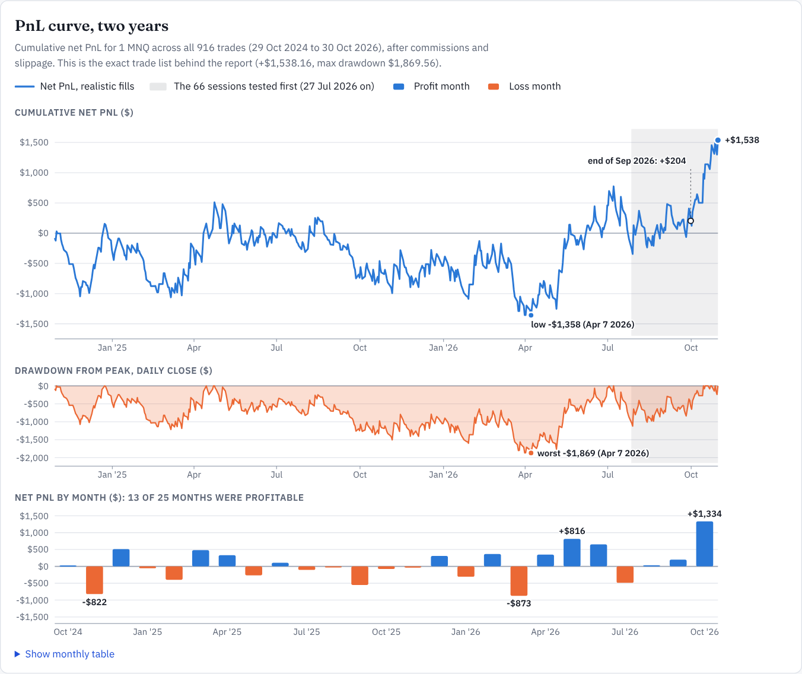
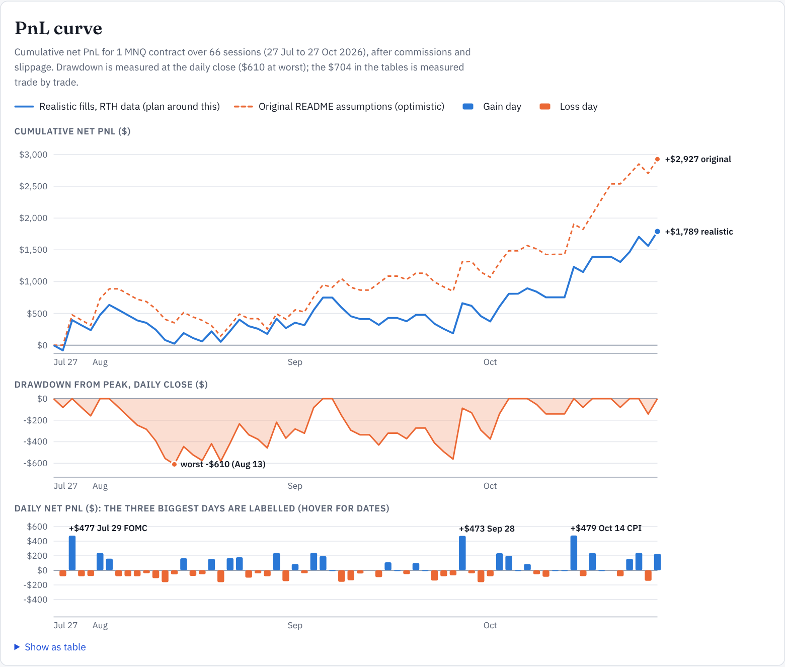

# nq_ibkr_bot_claude

Hardened rework of [`lantoraj/nq_ibkr_bot`](https://github.com/lantoraj/nq_ibkr_bot): same intraday MNQ/NQ strategy,
but with a realistic backtester, a statistical validation harness, and a live engine whose failure modes were fixed.

> **Status: research only; not validated for live trading.** On two years of data (517 sessions) the default strategy nets
> +$1,538 on 1 MNQ (profit factor 1.05, Sharpe 0.36, deflated Sharpe 0.20). The strong results from the first 66 sessions
> below do **not** hold up. Full results: [`reports/research_2y.md`](reports/research_2y.md).

## Two-year validation (supersedes the 66-session results further down)

Data: back-adjusted per-contract 2-minute MNQ bars, 2024-10-29 to 2026-10-30, produced by `download-history --years 2 --include-eth`.

| | 66 sessions | 517 sessions |
|---|---|---|
| Net PnL, 1 MNQ | +$1,789 | **+$1,538** (about $750 a year) |
| Profit factor / Sharpe | 1.52 / 2.72 | **1.05 / 0.36** |
| Max drawdown | $704 | $1,870 |
| README-era optimistic fills | +$2,927 | +$181 |

* **Nearly all profit came in one month.** Through September 2026 the strategy had earned only +$204 in 23 months; October 2026
  alone made +$1,334 (87% of the total). The equity curve bottomed at -$1,358 (7 Apr 2026) and went 434 days without a new high.
  First year -$673, second year +$2,211. The 66 sessions tested first were the strongest stretch.



* Only 13 of 25 months profitable; top 3 days = 93% of net profit; without the best 5 days the strategy loses $845.
* Costs matter: +$402 at double commission, -$1,055 with 3-tick stop slippage, 2 ticks worse entries and double commission.
* Tuning does not generalise: walk-forward re-optimisation made +$854 vs +$1,624 for the fixed defaults.
* Several components hurt: removing the confidence gate, the PDH/PDL guard or the time-decay stop each raises net profit;
  pullback-only entries make +$3,500 (PF 1.13, 15/25 months) but are the best of ~90 variants tried, so they need forward testing.
* Still beats random entries (97th percentile, random p95 +$730), but deflated Sharpe is 0.20: luck alone is expected to give 0.95.
* The event calendar covers only 4 of 25 months, so the event-day and context results are unreliable until it is extended.
* Entry-option findings flipped sign versus the 66-session sample, which indicates noise; none are adopted.

Interactive report: the "MNQ Two-Year Validation" HTML page. Next: simplify and freeze the rules, extend the event calendar,
test the overnight guard (the new data has overnight bars), measure real slippage on paper, and test forward on unseen data.

## What changed vs the baseline

| Area | Baseline | Now |
|---|---|---|
| Backtest fills | fill at signal-bar close | next-bar marketable limit (open-or-limit fill, 3-bar timeout), gap-aware stops |
| Session data | CSV includes 16:00-17:00 ET bars in VWAP / PDH / PDL | RTH-only (configurable) |
| Metrics | "Sharpe" = per-trade t-stat | daily-PnL Sharpe, expectancy in R, scratch-aware win rate, bootstrap drawdown |
| Validation | none (all tuning in-sample) | `research.py`: ablation, stress, sensitivity grids, walk-forward, random-entry null, bootstrap |
| Config | 9 dead fields; RSI bands & other thresholds hard-coded | every field consumed; thresholds in `StrategyConfig` |
| `strategy.py` | 8 copy-pasted long/short blocks | one direction-signed implementation (verified identical to baseline: 109 trades, +$2,926.84) |
| Live stop moves | set `order.stopPrice` (not a field of `StopOrder`; raises `AttributeError`) so **break-even / time-decay never worked live** | `order.auxPrice`; same `StopManager` as the backtester |
| Bracket exits | TP and SL not OCA-linked | explicit OCA group |
| Flatten | cancel then immediately market-close (can reverse the position if the stop fills meanwhile) | cancel -> wait -> re-read position -> close remainder |
| Restart | in-memory state lost, daily limits reset | state file; recover/adopt/flatten orphan positions |
| PnL accounting | `realizedPNL != 0` filter (scratch trades uncounted) | PnL from the bracket's own fills + commissions |
| Connectivity | none | auto-reconnect with back-off, stale-data watchdog, resubscribe |
| Contract | nearest unexpired contract | rolls 8 days before expiry |
| Time zones | naive timestamps silently treated as UTC | naive timestamps rejected; IB bars requested as UTC |
| Live safety | warning log only | `--confirm-live I-ACCEPT-REAL-MONEY-RISK` required |
| Tests | 4 | 78 (baseline-parity golden test, lookahead audit, backtest mechanics, fake-IB execution tests, market-context and entry-option tests) |

## Layout

```
config.py          all settings (strategy / risk / costs / backtest / execution)
indicators.py      EMA, ATR, RSI, VWAP+z, Kalman velocity, variance-ratio Hurst, PDH/PDL, ORB, RTH filter
strategy.py        signal engine (+ RandomEntryStrategy null benchmark)
scalp_lab.py        bar-level scalp-signal event study (multiple-testing aware)
microstructure.py  tick features (queue imbalance, OFI, microprice, trade flow) + net-of-cost study
tick_recorder.py   record top-of-book quotes/trades to CSV; tick_lab.py runs the study
stats_tests.py     probabilistic/deflated Sharpe, minimum track record and backtest length
history.py          long-history download: per-contract, paced, rolled and back-adjusted
trade_mgmt.py      StopManager: break-even + time-decay, shared by backtest and live
context.py         opening gap + overnight (Globex) range per session
events.py          economic-event calendar: entry blackout, flatten-before-event, skip tier-1 days
entry.py           entry planning shared by backtest and live: retrace limit, confirmation bar
risk_manager.py    daily limits, session window, sizing, serialisable state
backtest.py        bar-by-bar simulator (signal_close legacy model | next_bar realistic model)
metrics.py         metrics + bootstrap
research.py        robustness harness -> reports/research_report.md
ibkr_execution.py  live/paper runner (ib_async)
state_store.py     atomic JSON persistence
main.py            CLI
tests/             pytest suite
reports/           generated research report + trade list
docs/legacy/       the baseline READMEs
```

## Usage

```bash
pip install -r requirements.txt
python -m pytest -q

python main.py --mode backtest --csv data/mnq_2m_3months.csv                     # realistic fills (default)
python main.py --mode backtest --csv data/mnq_2m_3months.csv --fill-model signal_close   # baseline's optimistic model
python research.py --sections all                                                # full validation report (~3 min)

python main.py --mode download-history --duration "1 Y" --csv data/mnq_2m_1y.csv  # needs TWS/Gateway
python main.py --mode paper --symbol MNQ                                          # paper port 7497
python main.py --mode live  --symbol MNQ --confirm-live I-ACCEPT-REAL-MONEY-RISK
```

## Scalping: what the data says, and the path to a real answer

`python scalp_lab.py` runs an event study on 2-minute bars (report: `reports/scalp_report.md`). 170 signal variants
(VWAP z, EMA distance, RSI(2), IBS, Bollinger, 3-bar momentum, volume spikes, opening-range breaks), each followed and
faded, held 2-12 minutes, entry at the next bar open, net of costs.

* **No bar-level scalp edge.** 1 variant has a positive net edge at t > 2 (about 4 expected by chance); none pass a
  multiple-testing bar and a both-halves check. Lag-1 autocorrelation of 2-minute returns is 0.01.
* **Costs decide it.** A round trip costs about 1.12 pts on MNQ ($2.24) but 0.71 pts on NQ ($14.20). Per point of
  movement NQ is ~37% cheaper to trade, so any scalping idea should be tested with NQ costs.
* The lab itself is validated (`tests/test_labs.py`): a random walk yields no findings, a planted reversal effect is found.

A true scalper (seconds-to-minutes holds) needs data this repo did not have, so the tools to get it now exist:

```bash
python main.py --mode record-ticks --minutes 390     # during the session; top-of-book quotes + trades to data/ticks/
python tick_lab.py --quotes "data/ticks/MNQ_quotes_*.csv" --trades "data/ticks/MNQ_trades_*.csv"
```

`microstructure.py` computes queue imbalance, microprice deviation, order-flow imbalance (Cont-Kukanov-Stoikov) and signed
trade-flow imbalance on a 1-second grid, then evaluates each as a signal net of crossing the spread twice plus commission.
Record at least 2-4 weeks before drawing conclusions. Limits to keep in mind: the IB API adds tens to hundreds of ms of
latency, so only effects that last several seconds are reachable from this stack; passive (limit-order) scalping needs a queue
model and is not simulated here; there is NO live scalping mode, because nothing tested so far justifies one.

## Testing on a longer data set (the single most useful next step)

The bundled CSV is 66 sessions. The build environment could not reach a market-data source for more (the IBKR connector only
returns "last N bars from now" and nothing for expired contracts), so this has to be run where TWS/Gateway is available:

```bash
# 1. TWS or IB Gateway running with the API enabled (paper account is fine). ~25 min for 2 years (IB pacing limits).
python main.py --mode download-history --years 2 --include-eth --csv data/mnq_2m_2y.csv

# 2. Fill data/economic_events.csv for the whole period (the event results are only valid where it has dates)

# 3. Re-run everything on the long set (walk-forward windows scale automatically)
python research.py --csv data/mnq_2m_2y.csv --out reports/research_2y.md
```

`--years N` downloads each quarterly contract separately in paced chunks, rolls on the same rule as the live bot
(8 days before expiry) and **back-adjusts** the older contracts by the roll spread, so there are no fake roll gaps (the old
`ContFuture` download injected them). Raw per-contract bars are cached in `data/cache/`, so an interrupted run resumes.
`--include-eth` also keeps overnight bars, which enables the overnight-range guard. The pipeline is covered by offline
tests but has not been run against a live TWS.

What to look for in the long-run report: whether profit is still concentrated in a handful of days (section 11), whether
the walk-forward result beats the fixed defaults, whether the VWAP z-band still earns its place (section 2), and whether the
random-entry percentile (section 7) stays high.



*Cumulative net PnL, drawdown and daily PnL for 1 MNQ over the 66-session sample (realistic fills vs the original optimistic
assumptions). Interactive version: the HTML research report.*

## What the validation said on the first 66 sessions (superseded by the two-year results above)

Full tables: [`reports/research_report.md`](reports/research_report.md).

* The baseline headline (+$2,927, PF 1.97) shrinks to **+$1,789, PF 1.52, max DD $704** once fills are next-bar,
  stops are gap-aware and VWAP/PDH/PDL use RTH bars only. After-hours bars alone are worth ~$870 of the baseline number.
* **Break-even is a risk-smoothing tool, not a profit source** (no-BE: +$1,970 but DD $983). The baseline credited it with
  most of the edge, and it never executed live.
* The **confidence gate (Kalman/Hurst "meta-labeling") adds nothing** at the default threshold (identical results with it
  off). Its weights are hand-set, not fitted. Candidate for removal.
* The **VWAP z-band is the component that earns its keep** (removing it: $1,171, DD $1,001).
* Defaults sit on a **local peak** of the ATR-multiplier x R:R grid, and a 1-tick change to entry price moves net PnL by ~$200:
  the result is noisy at this sample size.
* Walk-forward re-optimisation did **worse** out of sample (+$256) than the fixed defaults (+$1,041): more tuning = more overfit.
* Random entries with the same exits are profitable in ~35% of seeds; the strategy ranks at the ~98th percentile.
  Encouraging but not conclusive, given the strategy was selected after many variants were tried.
* Edge is concentrated in the last ~5 weeks (first half +$455, second half +$1,334).
* Bootstrap: ~6% chance a 111-trade sample is net negative; p95 max drawdown ~$1,300 per MNQ.

## Market-context filters (all default OFF)

| Flag | What it does |
|---|---|
| `--event-filter` | no entries from 10 min before to 15 min after an event in `data/economic_events.csv`; flattens any open position 5 min before an event (never hold through FOMC/CPI/NFP); optional `skip_tier1_days` |
| `--gap-filter` | blocks trades against an unfilled opening gap larger than 25% of the prior day's range |
| `--overnight-guard` | treats the overnight high/low as walls (like PDH/PDL); needs ETH bars: `download-history --include-eth` |

Findings on the 3-month sample (`reports/research_report.md`, section 9):

* **Correction after the deeper analysis (report section 11):** the 8 tier-1 event days did earn +$1,208, but that is
  two days: the 2026-07-29 FOMC day (+$477, the widest-range day in the sample) and the 2026-10-14 CPI day (+$479).
  The other six event days net +$252. Event days are not wider or more trending than other days on average, and only 2 of
  the 8 best days are event days. So this is a **profit-concentration** problem, not an event effect (see below).
  `skip_tier1_days` still hurts (net falls to +$582), but only because it removes those two days; do not enable it.
* The event blackout + pre-event flatten changed nothing in the backtest (no trade was open into an event), so it is pure
  risk control. Keep it on for live trading.
* The gap filter at 25-40% of the prior range keeps net PnL (+$1,782) with 14 fewer trades and lower drawdown ($574 vs $704),
  but 10% is worse and this is in-sample on roll-contaminated gaps. Not enough to enable by default.
* The overnight guard **could not be evaluated**: the bundled CSV starts at 09:30 ET. It is implemented and unit-tested.
* `data/economic_events.csv` was assembled from web search because bls.gov and federalreserve.gov were unreachable from the
  build environment. FOMC dates matched across sources; CPI dates are from secondary sites and marked UNVERIFIED. Confirm them
  and extend the file (it only protects against events it lists; the live runner warns when it is stale).
* The CSV is an unadjusted continuous contract; gaps near the September roll include calendar spread.

## Deflated Sharpe and minimum backtest length (report section 12)

`stats_tests.py` implements the Bailey & Lopez de Prado statistics; `research.py` counts the variants it actually evaluates
(90 distinct configurations) and uses their Sharpe spread to deflate the default's Sharpe.

* Default (realistic fills): annualised Sharpe **2.72** over 66 days, PSR 0.94, so even before deflation it falls just short of
  95% confidence (77 days are needed, 66 are available).
* After 90 trials, luck alone is expected to produce an annualised Sharpe of **2.81**, which is above the strategy's 2.72.
  **Deflated Sharpe = 0.48** (0.95 would be convincing). The tests cannot distinguish the strategy from the best of many random ones.
* 66 days (0.26 years) supports **at most about 7 independent trials** at a Sharpe of 2.7. Ten trials already need 0.34 years,
  fifty need 0.7 years, ninety need 0.84 years, and a Sharpe near 1.5 would need about 2.8 years.
* `tests/test_stats.py` includes a calibration check: the best of 200 random strategies looks significant in >80% of runs
  without deflation, in <15% with it.
* N is a lower bound (the baseline author's v0-v4 tuning is not counted) and correlated variants lower the effective N, so read
  the DSR as a guide, not a p-value. The practical conclusion is simple: this sample is too short to validate a strategy with
  this many degrees of freedom; more data, not more tuning, is what helps.

## Profit concentration (report section 11)

* The top 3 days earn 80% of net profit and the top 5 earn 107%; **without the 5 best days the strategy loses $117.**
  Only 29 of 66 days are positive. This is a classic trend-following fat tail, not a smooth edge.
* Day range is the best explanation of a day's PnL (rank correlation +0.31); event status explains less (+0.17).
  Against 8 random days from the 24 widest-range days, the event days beat only 81% of placebos, so volatility explains
  most of it. Against any 8 random days they beat 98.5%.
* Nothing known before 09:45 predicted the big days (prior-day range, opening 15-minute range, opening gap, ATR: all
  rank correlations within +/-0.12). So a simple "trade only on volatile days" filter is not supported by this data.
* Practical meaning: expect long flat or losing stretches punctuated by a few large winners, and size/psychology accordingly.
  Whether those big days recur is the main thing a longer data set must answer.

## Entry-quality experiments (all default OFF; result: nothing beat the baseline)

Motivated by the 35 trades that fail within 3 bars (-$1,829). Flags: `--entry-style retrace --retrace-atr X`, `--confirm-bar`,
`--structural-stop`, `--max-extension-atr X`. Results are in `reports/research_report.md`, section 10.

| Idea | Result vs baseline (+$1,789, 111 trades) |
|---|---|
| Retrace limit (wait for a dip) | 0.10 ATR: +$2,163 but worse in the first half; 0.25: +$969; 0.50: -$426. Non-monotonic and degrading. No robust gain |
| Confirmation bar | +$86. **Waiting for confirmation destroys the edge**, the edge is in the early momentum entry |
| No-chase filter (close near EMA9) | -$619 to +$485. Most winning signals are extended bars, so filtering them out hurts |
| Structural (swing) stop | 2-bar swing: +$2,053 (better in both halves); 3-bar: +$1,420; 5-bar: +$1,082. Gets worse as the swing lengthens, within noise of the +/-$200 sensitivity seen earlier |

Takeaway: the data do not support changing the entry. The only candidates worth re-testing on a longer data set are the 2-bar
structural stop and a 0.10 ATR retrace, and both gains are inside the sample's noise.

## Next steps before trusting it

1. Pull 1-2 years of 2-min data (`download-history`) and re-run `research.py`; judge the strategy on that, not on these 66 days.
2. Download with `--include-eth`, back-adjust or use per-contract data, then re-test the gap and overnight filters.
3. Paper trade 4-6 weeks; compare actual fills against `next_bar` assumptions.
4. Decide on removing the confidence gate / simplifying parameters based on the longer sample.
5. `server_side_breakeven` (IB adjusted stop, survives bot death) is implemented but **untested against a live IB**; try on paper first.

## Claude Code trading toolkit (`.claude/`)

Installed from [everything-claude-trading](https://github.com/brainbytes-dev/everything-claude-trading) (MIT, commit 9a8fcfc):
29 skills, 9 agents and 9 slash commands, pruned from 82/18/20 to what an intraday futures bot needs (`/backtest`, `/signal-research`, `/position-size`, `/stress-test`, `/trade-review`, `/market-regime`, `/alpha-decay`, `/data-pipeline`, `/strategy`). They load
automatically when Claude Code is opened in this repo. See `.claude/THIRD_PARTY_everything-claude-trading.md` for what was
changed (generated skill headers) and what was deliberately left out (the keyword-warning hooks and the MCP server template).
Most useful for this bot: `overfitting-prevention`, `walk-forward-optimization`, `monte-carlo-simulation`,
`transaction-cost-analysis`, `order-flow-analysis`, `tick-data-processing`, `position-sizing`, `regime-detection`. The 53 unrelated skills
(crypto, derivatives pricing, macro, portfolio allocation, ...) were removed to keep the context small.

## Known limits

* The execution layer is tested against a fake IB, not a real TWS/Gateway. Expect to shake out issues on paper.
* Fills assume a marketable limit that trades through; real NQ queue effects are not modelled.
* One instrument, one regime, 3 months.
